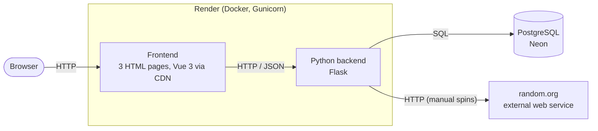

# Slot Machine Simulator

A web application that simulates a classic three-reel Las Vegas slot machine.
The machine is freely configurable (reel strips and paytable), every spin is
stored in a database, and an analysis view compares the configured
(theoretical) probabilities and Return to Player (RTP) with the results
actually achieved.

**Live app:** <https://slot-machine-nlsl.onrender.com/>

The app runs on the Render free tier. After a period without traffic the
service sleeps; the first request then takes about a minute.

SWEN project, MSc Business Informatics, FFHS, autumn semester 2026.

---

## Contents

- [Goal](#goal)
- [Features](#features)
- [Architecture](#architecture)
- [Tech stack](#tech-stack)
- [Run locally](#run-locally)
- [Tests and CI](#tests-and-ci)
- [Deployment](#deployment)
- [Project structure](#project-structure)
- [Documentation](#documentation)

---

## Goal

A slot machine is a simple game with an exactly calculable outcome: the reel
strips and the paytable define how much the machine pays back in the long run
(RTP). The application makes this visible. You configure a machine, see its
theoretical RTP and hit frequency while editing, play it manually or simulate
thousands of spins, and then check whether practice matches theory.

Details: [docs/requirements.md](docs/requirements.md).

## Features

| | Feature | Page |
|---|---|---|
| F1 | **Play:** single manual spin. The random numbers come from the external web service [random.org](https://www.random.org); if it is not reachable, Python is used instead. The source is stored per spin. | Play |
| F2 | **Autospin and mass simulation:** autospin plays spins one after another with a visible delay; the mass simulation runs any number of spins in the backend (at most 10,000 per request, the frontend splits larger runs). Both use Python's random generator. | Play |
| F3 | **Configure:** edit the number of positions per symbol on each of the three reels (at most 30 per reel) and the paytable (three of a kind, cherry count). Theoretical RTP, hit frequency and probability per rule are updated live. Saving always creates a new, immutable configuration. | Configure |
| F4 | **Analyse:** for one configuration, compare actual and theoretical RTP, hit frequency and hits per rule, optionally filtered by random source. Each value shows a 95 % expected range, so you can tell normal fluctuation from a real deviation. | Analyse |

## Architecture



Key ideas:

- **Game logic in plain Python** (`src/app/game.py`), without Flask or
  database, fully unit tested.
- **Theory and practice use the same function.** The theoretical values are
  not calculated with formulas: all symbol combinations (at most
  6 x 6 x 6 = 216) are evaluated with the same `evaluate()` function used
  when playing. The analysis lets the database group the spins by their three
  symbols and evaluates each group with `evaluate()` as well, so it stays fast
  with any number of spins.
- **Immutable configurations:** every spin references the configuration it
  was played with; editing creates a new configuration.
- **Symbol codes in the backend** (`CHERRY`, `BAR`, ...), emoji only in the
  frontend.

More diagrams (components, data model, API, sequences):
[docs/architecture.md](docs/architecture.md).

## Tech stack

| Layer | Technology |
|---|---|
| Backend | Python 3.13, Flask, Gunicorn (Waitress for local use on Windows) |
| Frontend | Vue 3 via CDN, no build step; plain CSS |
| Database | PostgreSQL on Neon, plain SQL with `psycopg` (no ORM) |
| External web service | random.org (HTTP interface, no API key) |
| Packages | `uv`, dependencies in `pyproject.toml` / `uv.lock` |
| Tests and linting | `pytest`, `pytest-cov`, `ruff` |
| CI | GitHub Actions |
| Deployment | Docker image on Render, automatic on every push |

## Run locally

Prerequisites: Python 3.13+, [uv](https://docs.astral.sh/uv/) and a
PostgreSQL database (e.g. a free one on [Neon](https://neon.tech)).

```bash
git clone https://github.com/iceangel79/Slot_Machine.git
cd Slot_Machine
uv sync
```

Create a file `.env` in the project root (it is ignored by Git):

```env
DATABASE_URL=postgresql://<user>:<password>@<host>/<dbname>?sslmode=require
```

Start the application:

```bash
# Linux / macOS
uv run gunicorn --bind 127.0.0.1:8000 app.main:app

# Windows
uv run waitress-serve --port=8000 app.main:app
```

Open <http://localhost:8000>. On the first start the application creates the
tables and a default configuration "Classic (default)" (RTP 91.0 %).

With Docker instead:

```bash
docker build -t slot-machine .
docker run -p 8000:8000 -e DATABASE_URL="postgresql://..." slot-machine
```

## Tests and CI

```bash
uv run pytest            # tests with coverage report
uv run ruff check        # linter
uv run ruff format       # formatter
```

- **Game logic tests** (`tests/test_game.py`) need no database and no
  network. random.org is never called; tests replace it with `monkeypatch`.
- **API tests** (`tests/test_api.py`) need a separate test database. Add its
  connection string to `.env`:

  ```env
  TEST_DATABASE_URL=postgresql://...   # e.g. a Neon branch "test"
  ```

  Without `TEST_DATABASE_URL` the API tests are skipped (the pytest header
  says so), so they can never write into the production database.
- **CI:** GitHub Actions (`.github/workflows/ci.yml`) runs `ruff check` and
  `pytest` on every push and pull request, with a fresh PostgreSQL service
  container as test database.

## Deployment

Render builds the `Dockerfile` and deploys automatically on every push to
GitHub. The only setting is the environment variable `DATABASE_URL`
(the Neon production branch). Tables and the default configuration are
created at startup, so a new database needs no manual setup.

Note: Render deploys independently of the CI result.

## Project structure

```text
src/app/
  main.py        Flask app: JSON API and static files
  game.py        game logic: spin, paytable, theoretical values, analysis
  rng.py         random sources: random.org with fallback, Python
  db.py          database access (plain SQL)
  schema.sql     tables and index, executed at startup
  static/        frontend: index.html (play), configure.html, analyse.html,
                 common.js (emoji table), style.css
tests/           pytest: game logic and API
docs/            requirements, architecture, decisions, diary
```

More: [docs/directories.md](docs/directories.md).

## Documentation

- [Requirements](docs/requirements.md)
- [Architecture](docs/architecture.md)
- [Decision records](docs/decisions/):
  - [0001 Docker and Render](docs/decisions/0001-20261022-docker-vs-render.md)
  - [0002 Tech stack](docs/decisions/0002-20261024-tech.md)
  - [0003 Documentation conventions](docs/decisions/0003-20261024-documentation-conventions.md)
  - [0004 Backend framework: Flask](docs/decisions/0004-20261024-backend-framework-flask.md)
  - [0005 Frontend: Vue 3 via CDN](docs/decisions/0005-20261024-frontend-vue-via-cdn.md)
  - [0006 Database: PostgreSQL on Neon](docs/decisions/0006-20261024-database-postgres-on-neon.md)
  - [0007 Immutable, versioned configurations](docs/decisions/0007-20261024-immutable-versioned-configurations.md)
  - [0008 Random number sources](docs/decisions/0008-20261024-random-number-sources.md)
  - [0009 Symbol codes and emoji display](docs/decisions/0009-20261024-symbol-codes-and-emoji-display.md)
  - [0010 Database access: plain SQL](docs/decisions/0010-20261025-database-access-plain-sql.md)
  - [0011 CI with GitHub Actions](docs/decisions/0011-20261025-ci-with-github-actions.md)
  - [0012 Game logic and paytable rules](docs/decisions/0012-20261025-game-logic-and-paytable-rules.md)
  - [0013 Default configuration](docs/decisions/0013-20261025-default-configuration.md)
  - [0014 Access to random.org](docs/decisions/0014-20261025-random-org-access.md)
  - [0015 Separate test database](docs/decisions/0015-20261025-separate-test-database.md)
  - [0016 Configuration editor](docs/decisions/0016-20261025-configuration-editor.md)
  - [0017 Maximum reel length](docs/decisions/0017-20261025-maximum-reel-length.md)
  - [0018 Analysis of spins](docs/decisions/0018-20261025-analysis-of-spins.md)
- [Development diary](docs/diary.md) (German)

AI assistance (Claude, Anthropic) was used for planning, reviews and code
drafts; this is declared in the diary.
