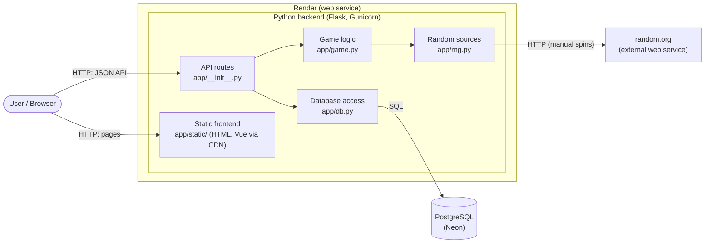
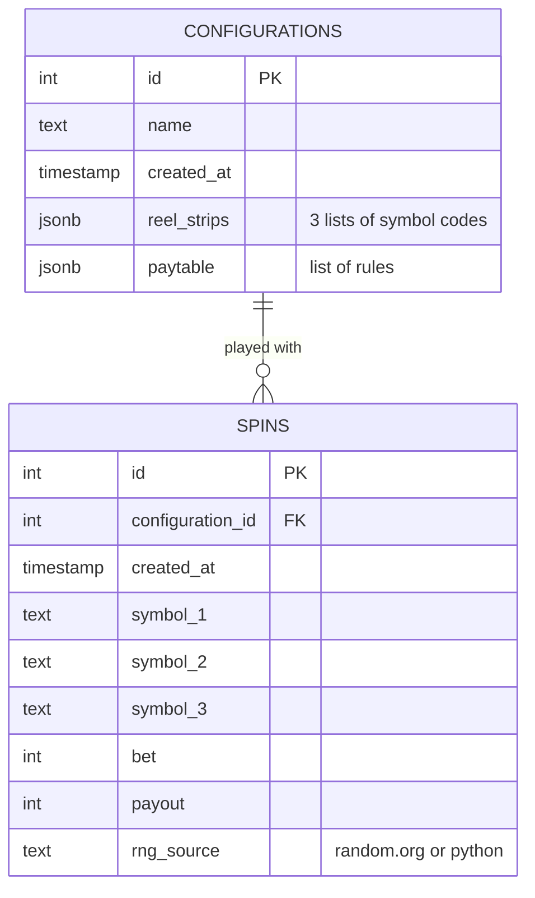
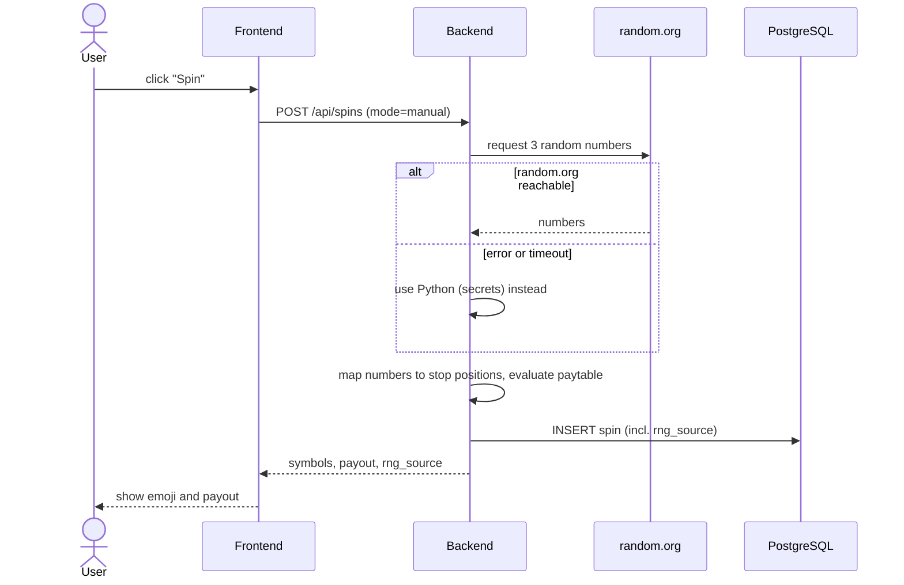

# Architecture

Date: 2026-10-24

Overview of the Slot Machine Simulator. Requirements: `docs/requirements.md`.
Decisions: `docs/decisions/` (in particular 0004 to 0009).

## Components

| Component | Responsibility |
|---|---|
| Static frontend | Three views: play, configure, analyse. Maps symbol codes to emoji. No calculations. |
| API routes | Receives requests, validates input, returns JSON. |
| Game logic | Pure Python, no Flask: draws stop positions, evaluates the paytable, calculates theoretical probabilities, hit frequency and RTP. Unit tested. |
| Random sources | random.org for manual spins, Python (`secrets`) for autospin and mass simulation and as fallback. |
| Database access | Reads and writes configurations and spins. |
| PostgreSQL (Neon) | Persistent storage. Connection string in `DATABASE_URL`. |
| random.org | True random numbers based on atmospheric noise. |

## Data model

Notes:

 * Configurations are immutable (decision 0007). A change creates a new row.
 * Reel strips and paytable are stored as JSON in one row each. They are
   always read and written as a whole, so separate tables are not needed.
 * The bet is fixed at 1 credit per spin in the MVP; the payout is the
   paytable multiplier.

## API (first draft)

| Method | Path | Purpose |
|---|---|---|
| GET | `/api/configurations` | List all configurations |
| GET | `/api/configurations/<id>` | One configuration |
| POST | `/api/configurations` | Save a new configuration |
| POST | `/api/configurations/evaluate` | Calculate probabilities and RTP without saving (live in the editor) |
| POST | `/api/spins` | Execute spins: `{configuration_id, mode, count}` with `mode` = `manual` (1 spin, random.org) or `auto` (n spins, Python) |
| GET | `/api/configurations/<id>/analysis` | Theoretical vs. actual values for one configuration |

Autospin with delay is a loop in the frontend that calls `/api/spins` with
`mode=auto, count=1`. Mass simulation is a single call with a large `count`.

## Manual spin with fallback

