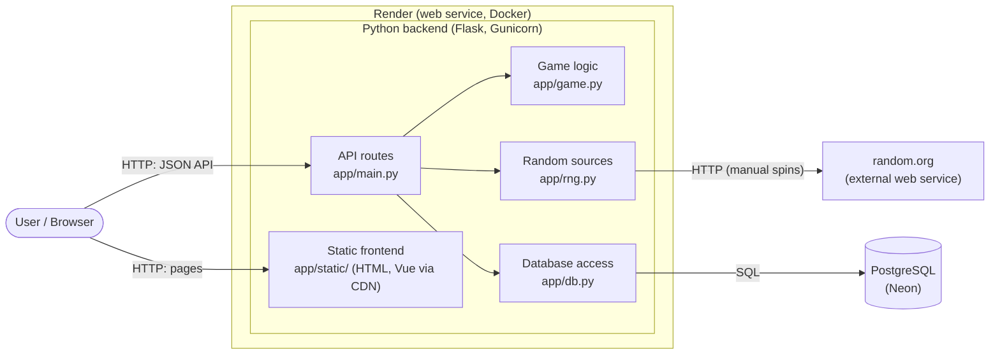
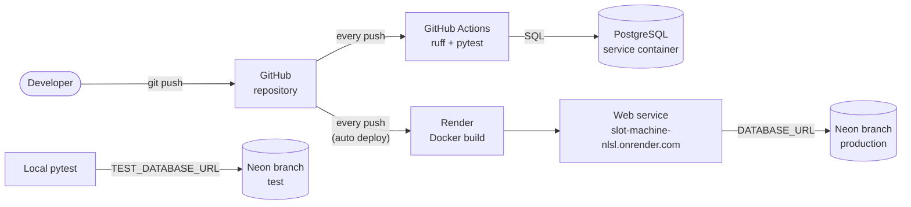
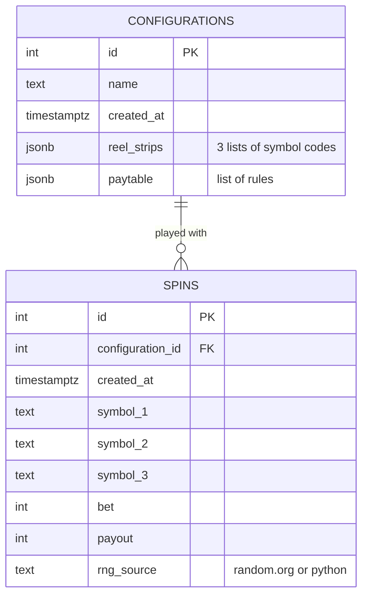
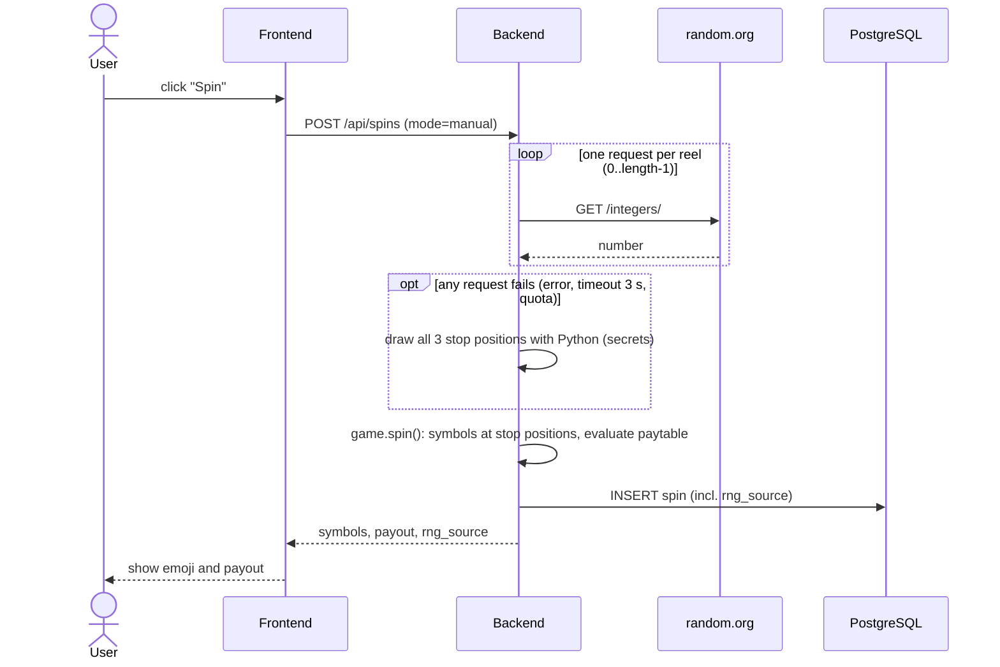
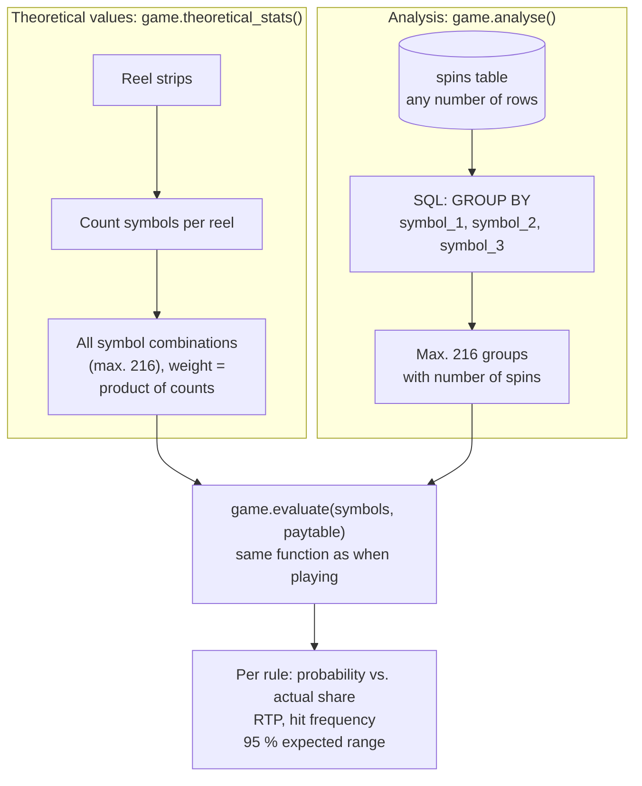

# Architecture

Date: 2026-10-24, updated 2026-10-26

Overview of the Slot Machine Simulator. Requirements: `docs/requirements.md`.
Decisions: `docs/decisions/` (0004 to 0018).

## Components

| Component | Responsibility |
|---|---|
| Static frontend | Three pages: `index.html` (play), `configure.html`, `analyse.html`. `common.js` maps symbol codes to emoji, `style.css` holds the shared styles. No calculations (decisions 0005, 0016). |
| API routes | Receives requests, validates input, returns JSON. Calls the random source and passes the drawn stop positions to the game logic. |
| Game logic | Pure Python, no Flask, no database: evaluates the paytable, executes spins with a given random source, calculates theoretical values and the analysis (decisions 0012, 0018). Unit tested. |
| Random sources | random.org for manual spins with fallback to Python; Python (`secrets`) for autospin and mass simulation (decisions 0008, 0014). |
| Database access | Plain SQL with `psycopg`: configurations, spins, grouped spins for the analysis (decision 0010). |
| PostgreSQL (Neon) | Persistent storage. Connection string in `DATABASE_URL` (decision 0006). |
| random.org | True random numbers based on atmospheric noise. |

## Deployment and CI

 * CI and deployment run in parallel; Render does not wait for the CI result
   (decision 0011).
 * Tests never use the production database (decision 0015).
 * Tables, index and default configuration are created at startup
   (decisions 0010, 0013).

## Data model

Notes:

 * Configurations are immutable (decision 0007). A change creates a new row.
 * Reel strips and paytable are stored as JSON in one row each. They are
   always read and written as a whole, so separate tables are not needed.
 * The bet is fixed at 1 credit per spin; the payout is the paytable
   multiplier.
 * The winning rule of a spin is not stored; the analysis recalculates it from
   the three symbols (decisions 0012 and 0018). An index on
   `spins (configuration_id)` keeps the analysis fast with many spins.

## API

| Method | Path | Purpose |
|---|---|---|
| GET | `/api/health` | Check that the backend runs and the database is reachable |
| GET | `/api/configurations` | List all configurations (id, name, created_at), newest first |
| GET | `/api/configurations/<id>` | One configuration with reel strips and paytable |
| POST | `/api/configurations` | Save a new configuration: `{name, reel_strips, paytable}` |
| POST | `/api/configurations/evaluate` | Theoretical values without saving (live in the editor) |
| POST | `/api/spins` | Execute spins: `{configuration_id, mode, count}` with `mode` = `manual` (1 spin, random.org) or `auto` (1 to 10,000 spins, Python) |
| GET | `/api/configurations/<id>/analysis` | Actual vs. theoretical values; optional `?source=random.org` or `?source=python` |

Invalid input returns `400` with `{"error": "..."}`, an unknown configuration
`404`.

Autospin with delay is a loop in the frontend that calls `/api/spins` with
`mode=auto, count=1`. The mass simulation calls `/api/spins` with up to
10,000 spins per request and repeats the call until the requested number is
reached, so no request runs into Gunicorn's timeout of 30 seconds.

## Manual spin with fallback

## Theory and practice: one evaluation function

The theoretical values and the analysis both reuse `game.evaluate()`, the
function that decides the payout of a spin (decisions 0012 and 0018). The
amount of work in Python is constant: at most 6 x 6 x 6 = 216 symbol
combinations, independent of the reel length and of the number of spins.

Expected range: theoretical value +/- 1.96 standard errors. Standard error of
a frequency: `sqrt(p * (1 - p) / n)`; of the RTP: `sigma / sqrt(n)`, with the
standard deviation `sigma` of the payout per spin calculated exactly from the
rule probabilities.
